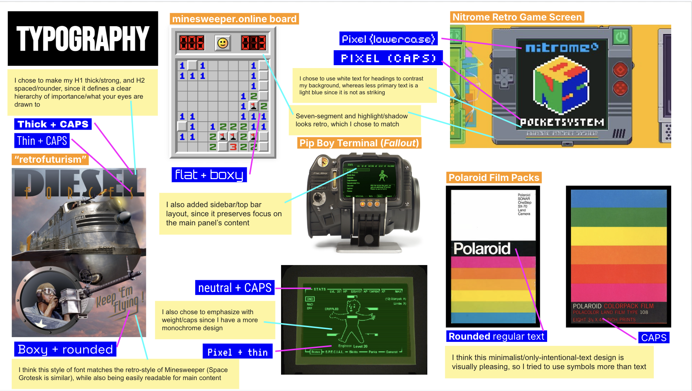
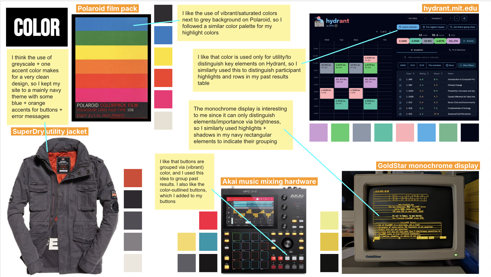

# Personal Project 3: Beta

## Deployed App

My deployed app, Teamsweeper, is available [here](https://teamsweeper.mit-sdg.dev) ([https://teamsweeper.mit-sdg.dev](https://teamsweeper.mit-sdg.dev)).

## Automated Testing

My Bun testbench is available [here](../app/tests/). It tests each concept's principle, additional scenarios, and rejected requests; assertions check for maintained invariants, unchanged state after refusal, and correct return results.

The instructions for running the testbench are listed in the README [here](../README.md)

The output of my automated concept/integration testing is visible [here](./refs/p3-tests.txt).

## Visual Design Study

Below are my visual design study slides (also linked [here](https://docs.google.com/presentation/d/12Dv1MVFWIcl5h8x9Pc4ztNnX8XX8Qj4gwKlgfCffN-4/edit?usp=sharing)).

  
  

## Updated Core User Journey

Alice creates a private Teamsweeper room, copies its new code, and shares it with Bob. Then, Bob joins the lobby by code. Alice adjusts the settings to a beginner Minesweeper board, and begins the game. The two players solve the synchronized puzzle by revealing cells and placing flags. Each move appears for both players automatically without page refreshing. When Bob is unsure about a cell, he highlights it, and Alice highlights nearby cells to explain the solution. They continue until every safe cell is revealed, and they see the shared win statistics.

After the first game, Alice chooses Bob as the next host and confirms the reassignment. Bob starts another game with the same settings, and they play two more rounds. After three games, they use Past Results to compare their attempts on the same Beginner board settings. They rank their wins by time to find their fastest round, then switch to efficiency to see whether it was also their most efficient. Finally, they include losses to review all their attempts together.

## Updated Screen Recording

My Beta demo is viewable [here](https://youtu.be/Ga1wg9GUeek).